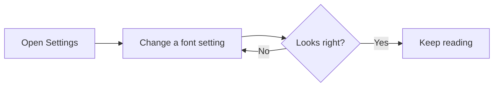

# Font and Readability Test

Use this page to check the `markdownForHumans.font.*` settings. Open Settings (`Cmd+,`), search for `markdownForHumans.font`, and change one setting at a time while this page stays open. Every change should apply at once, with no reload.

> [!TIP]
> To change everything in one go, open **Preferences: Open User Settings (JSON)** and paste one of the blocks from the "Settings to paste" section at the end.

## 1. What to try

| Step | Change | What you should see |
| --- | --- | --- |
| 1 | Nothing | This page looks the same as in the released extension |
| 2 | Font Family: `Georgia` | Paragraphs and headings switch to a serif font; code stays monospace |
| 3 | Font Family: `Verdana`, then `Comic Sans MS` | Prose changes each time; diagram labels and math do not |
| 4 | Font Family: `No Such Font` | Prose stays in the standard font |
| 5 | Weight: `500`, then `300` | Paragraphs get heavier, then lighter; headings and **bold** keep their weight |
| 6 | Line Height: `1.8`, then `2.4` | Lines in paragraphs, lists, quotes and table cells move apart; headings and code do not |
| 7 | Letter Spacing: `0.05`, then `0.12` | Letters in prose move apart; code and math do not |
| 8 | Word Spacing: `0.16`, then `0.5` | Gaps between words grow; columns in the code block stay aligned |
| 9 | Zoom: `150` with a font set | Everything scales, the font stays |
| 10 | Clear every setting | Back to the look of step 1 |

## 2. Letter shapes

Readers who mix up similar letters look here first. In a good reading font each of these is easy to tell apart.

Il1 | O0o | rn m | cl d | b d p q | a o e c | vv w | 5 S | 2 Z | 8 B

The quick brown fox jumps over the lazy dog. Pack my box with five dozen liquor jugs. Sphinx of black quartz, judge my vow.

minimum illumination, Illinois, barn burn, modern modem, clear dear, 1,000,000 and 0.001

## 3. Headings

# Heading level 1

## Heading level 2

### Heading level 3

#### Heading level 4

##### Heading level 5

###### Heading level 6

A long heading wraps onto a second line so you can judge heading line height:

## Choosing a typeface that stays comfortable after an hour of careful reading and editing

## 4. Inline styles

Plain text with **bold text**, *italic text*, ***bold italic***, ~~struck text~~, a [link to the VS Code docs](https://code.visualstudio.com/docs) and `inline code`. Press <kbd>Cmd</kbd> + <kbd>B</kbd> for bold. Water is H<sub>2</sub>O and the area is 12 m<sup>2</sup>.

Inline math such as $E = mc^2$ and $a^2 + b^2 = c^2$ should keep its own font and spacing.

## 5. Lists

- A first bullet with enough words to wrap onto a second line when the window is narrow, so line height inside lists is easy to see
- A second bullet
  - A nested bullet
  - Another nested bullet with `inline code`
- A third bullet

1. First numbered step
2. Second numbered step
3. Third numbered step

- [x] A finished task
- [ ] An open task
- [ ] Another open task with a longer description that wraps onto a second line in a narrow window

## 6. Quote and alerts

> Reading is a slow conversation with someone who is not in the room. The page should get out of the way, so that only the voice remains.

> [!NOTE]
> A note alert. Its label and body follow the body font.

> [!WARNING]
> A warning alert with a second sentence, long enough to wrap, so you can check spacing inside callouts.

## 7. Table

| Setting | Default | Try |
| --- | --- | --- |
| Font Family | empty | `Georgia` |
| Weight | 400 | 500 |
| Line Height | 1.58 | 1.8 |
| Letter Spacing | 0 | 0.05 |
| Word Spacing | 0 | 0.16 |

## 8. Code, math and a diagram

These three should not change with any font setting.

```ts
// Columns must stay aligned when word spacing is raised.
const settings = {
  family:        'Georgia',
  weight:        500,
  lineHeight:    1.8,
  letterSpacing: 0.05,
  wordSpacing:   0.16,
};
```

$$
\int_0^1 x^2 \, dx = \frac{1}{3}
$$



Labels inside the diagram must not be clipped at any setting.

<!-- An HTML comment marker. It stays small and monospace. -->

## 9. A longer read

Read this section top to bottom at your chosen settings. It is here to show how the text feels after a few minutes, which a single line never can.

A typeface is a tool, and like any tool it suits some hands better than others. Most of us never think about it. We open a document, the words appear, and we read. For a large number of people that is not how it goes. The letters crowd one another, a line is lost on the way back to the left margin, and the eye lands on the same sentence twice. None of this is about intelligence or effort. It is about the small mechanics of how the eye moves and how the mind turns shapes into words.

Three things do most of the work. The first is the shape of the letters. In some fonts a capital I, a lowercase l and the digit 1 are nearly the same stroke, and b, d, p and q are one shape turned four ways. A font drawn for clarity gives each of them a feature of its own: a tail, a slant, a heavier bottom. The reader stops guessing, and guessing is what tires people out.

The second is the space between lines. When lines sit close together, the eye has to find the start of the next one with very little room for error. Add a little air and the return sweep becomes easy. Add too much and the paragraph falls apart into separate lines that no longer feel connected. There is no single right value. It depends on the font, the size and the person, which is exactly why it should be a setting and not a decision made for everyone.

The third is the space between letters and between words. Slightly wider letter spacing can stop neighbouring letters from blurring together. Words then need more room too, or the gaps inside a word start to look like the gaps between words and the text turns into an even stream with no landmarks. The two settings are meant to be moved together, a little at a time.

What matters in the end is not any one number but the freedom to change it. A reader who knows what works for them should be able to make this editor look that way in a minute, and then forget about the settings and get on with reading and writing. If you reach the end of this section without thinking about the font at all, the settings are doing their job.

## 10. The VS Code editor font

Turn on **Font: Use Editor Font** and the prose takes your VS Code editor font: `editor.fontFamily`, `editor.fontWeight` and `editor.fontSize`, including values under `"[markdown]"`. With the VS Code defaults that font is monospace, so the whole page turns monospace. Font Family and Weight above still win when you set them.

## Settings to paste

A comfortable reading setup:

```json
{
  "markdownForHumans.font.family": "Georgia, serif",
  "markdownForHumans.font.weight": 400,
  "markdownForHumans.font.lineHeight": 1.8,
  "markdownForHumans.font.letterSpacing": 0.03,
  "markdownForHumans.font.wordSpacing": 0.1
}
```

The widest values, to look for clipped or overlapping text:

```json
{
  "markdownForHumans.font.family": "Verdana",
  "markdownForHumans.font.weight": 900,
  "markdownForHumans.font.lineHeight": 3,
  "markdownForHumans.font.letterSpacing": 0.5,
  "markdownForHumans.font.wordSpacing": 1
}
```

Your VS Code editor font for Markdown only:

```json
{
  "markdownForHumans.font.useEditorFont": true,
  "[markdown]": {
    "editor.fontFamily": "Charter, Georgia, serif",
    "editor.fontWeight": "500",
    "editor.fontSize": 16
  }
}
```

## Checklist

- [ ] Step 1 looks the same as the released extension
- [ ] Each setting applies at once, in this file and in a second open file
- [ ] Code blocks, inline code, math and the diagram never change font
- [ ] No clipped or overlapping text at the widest values
- [ ] Light and dark themes both look right
- [ ] After clearing the settings the page is back to step 1
